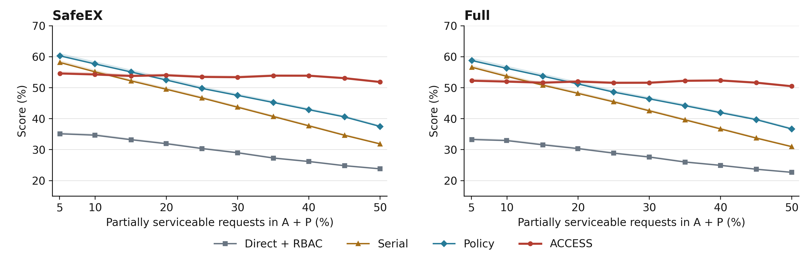

ACCESS: Supplementary Experiments

Sensitivity to the Proportion of Partially Serviceable Requests

Post-submission extension | DeepSeek Flash | Balanced cohort: 1,050 requests

S1. Experimental question and design

This extension asks whether the overall output-fulfillment ranking changes when requests with authorized partial outputs account for a larger share of evaluation. In the original output-evaluation cohort, 1,402 benchmark-allowed requests and 80 reference-positive benchmark-denied requests make up 1,482 requests; the latter account for only 5.40%. We construct a balanced cohort containing 525 benchmark-allowed requests (A) and 525 reference-positive benchmark-denied requests (P), following the original study's labels and fixed-reference convention. All four methods are evaluated on the same 1,050 request IDs.

The experiment combines real model outputs from the original study and a subsequent run on 445 new P requests. The balanced analysis reuses those outputs; it performs no additional inference. Cohort construction and selection use input metadata and fixed references, independently of candidate scores. The protocol records a retrospective analysis rather than a prospective preregistration.

S2. Cohort construction and reference validation

A request is a source question at a particular specificity level and effective role policy. L0, L1, and L2 vary how explicitly the original requirements are stated; L2 retains the original question. Different levels or policies for one source question are related observations. We identify repeated effective cases by source question, level, and allowed-column set, rather than by role name alone.

**Reference convention.** The A sampling pool consists of all 1,402 requests labeled allowed in the original benchmark. P retains all 80 reference-positive requests from the original study and adds 445 requests with authorized retained-output references. The original benchmark labels and the 80 original reference targets are unchanged. A and P denote evaluation partitions; candidate SQL is independently checked for authorization, execution, and output correctness.

The 445 expansion requests use existing role permissions for 148 requests and additive grants for 297; it contains no permission revocations. These 445 requests span 58 source questions and 149 question/policy combinations. Permissions are fixed before each run and shared by all methods. A complete Gold query remains blocked in every added case. An authorized SQL witness must reproduce a nonempty proper projection of the Gold output while preserving necessary conditions, complete result rows, duplicate multiplicities, and required ordering. The expansion witnesses change output projection while retaining the non-output clauses.

**Selection.** All 525 P requests are retained. We select 525 A requests from the original 1,402-request pool without replacement, stratifying by dataset and level. Hamilton largest-remainder allocation determines stratum quotas; within each stratum, a fixed SHA-256 ordering of the seed and request ID determines selection. The seed is ACCESS_AP50_20261116_v1.

All 149 expansion question/policy combinations have authorized witnesses that score one under the evaluation matcher. Native SQLite authorization verifies the accessed columns. The 20 SQLite database snapshots used by the expansion match their recorded hashes. References and effective policies are fixed independently of candidate predictions.

---

S3. Composition and evaluation protocol

Table S1. Balanced cohort by dataset and specificity level.

| Dataset | Level | Original A pool | Selected A | Selected P |

| --- | --- | --- | --- | --- |

| BIRD | L0 | 169 | 63 | 51 |

| BIRD | L1 | 171 | 64 | 51 |

| BIRD | L2 | 170 | 64 | 51 |

| LiveSQLBench | L0 | 116 | 43 | 10 |

| LiveSQLBench | L1 | 112 | 42 | 12 |

| LiveSQLBench | L2 | 110 | 41 | 11 |

| Spider | L0 | 183 | 69 | 113 |

| Spider | L1 | 184 | 69 | 113 |

| Spider | L2 | 187 | 70 | 113 |

| Total | All | 1402 | 525 | 525 |

Selected A contains 175 requests at each level; P contains 174, 176, and 175 at L0, L1, and L2. The 1,050 requests represent 369 source-question clusters; P represents 76. Sampling A does not require selecting every sibling level of a question.

**Methods and settings.** We compare Direct + RBAC, Serial, Policy, and ACCESS using DeepSeek Flash. The expansion retains the original method implementations and prompt variants: Direct and Serial use their RBAC SQL prompts; Policy and ACCESS hand their refined requests to the original Text-to-SQL prompt. SQL generation uses a 4,096-token output budget, temperature 0, and thinking disabled. ACCESS retains the original configuration of 30 user turns, 80 calls, and two retries for unclosed sessions. Reference SQL supports the simulated user and independent evaluation; it is not included in the clarification-agent or SQL-backend input. Historical calls were made in separate batches.

S4. Metrics and evidence treatment

**SafeEX** is the request-weighted mean of the fraction of fixed target output columns that jointly match the reference. Credit requires a fully authorized, successfully executing candidate and complete projected result rows, including duplicates and required order. Authorization covers all referenced columns, including non-output predicates, joins, aggregates, and ordering. **Full** is the fraction with request-level SafeEX equal to one. It measures complete fixed-reference fulfillment; a P reference can cover only part of the original goals, so Full does not necessarily mean fulfilling the entire original request. Extra authorized candidate columns do not by themselves invalidate Full.

Refusal, absent SQL, confirmed unauthorized access, and failed execution receive zero. Failed expansion attempts remain in the denominator: ACCESS has 21 unresolved outcomes and one internal validation failure; Policy has one response-format failure. Delivered expansion requests whose backend generation was interrupted by a scheduler exit were completed from their existing sessions; the clarification retry budget and method code were unchanged.

The audit reconciles all 118 historically uncertain DeepSeek scoring records, not only selected records, without changing candidate SQL. When two empty results leave column correspondence unidentified, a request retains evidence bounds [0, 1], unless a confirmed failure establishes zero. Selected-cohort uncertainty occurs only in A: 3, 4, 5, and 4 records for Direct, Serial, Policy, and ACCESS, respectively. All P scores are resolved. Metric ranges below average the evidence endpoints; they are distinct from the bootstrap intervals in Section S7.

---

S5. Results on the balanced cohort

Table S2. Output fulfillment on the 50/50 cohort (%).

| Method | SafeEX | Full | SafeEX on A | SafeEX on P |

| --- | --- | --- | --- | --- |

| Direct + RBAC | 23.80-24.09 | 22.67-22.95 | 36.41-36.98 | 11.19 |

| Serial | 31.85-32.23 | 30.95-31.33 | 60.86-61.62 | 2.84 |

| Policy | 37.49-37.96 | 36.67-37.14 | 62.54-63.50 | 12.43 |

| ACCESS | 51.85-52.23 | 50.48-50.86 | 54.65-55.41 | 49.05 |

Overall N = 1,050; each partition N = 525. Ranges are scoring evidence bounds. A single value indicates resolved evidence. Methods share exactly the same requests and reference targets.

ACCESS reaches 51.85-52.23% overall SafeEX, compared with 37.49-37.96% for Policy and 31.85-32.23% for Serial. Its overall Full is 50.48-50.86%, compared with 36.67-37.14% for Policy. The SafeEX lower-endpoint advantage over Policy is 14.36 percentage points; even ACCESS's lower endpoint exceeds Policy's upper endpoint by 13.89 points.

The partition results explain this ordering. ACCESS has lower SafeEX on A than Policy (54.65% versus 62.54% at lower endpoints), but substantially higher SafeEX on P (49.05% versus 12.43%). With equal partition sizes, overall SafeEX equals one half of each partition's score. The A and P differences contribute -3.95 and +18.31 points to the overall difference, respectively, yielding +14.36 points, with values rounded independently. ACCESS's advantage here reflects stronger retained-output fulfillment alongside a remaining cost on benchmark-allowed requests.

S6. Sensitivity to the proportion of P requests

To construct each curve, we fix the same 525 A requests and add nested prefixes of P in a metadata-only SHA-256 ordering using the fixed seed and the tag P_curve. The ten target shares range from 5% to 50%. Integer counts determine the actual plotted shares. Every point aggregates the corresponding recorded request-level outputs; no score is generated by interpolating partition means.

Figure S1. SafeEX and Full as the P proportion increases. Lines show lower evidence endpoints; shaded bands show upper endpoints. Bands represent scoring uncertainty, not confidence intervals. A is fixed; P is nested; all methods use the same requests at each point.

At the first point (28 P requests; 5.063%), ACCESS's SafeEX is 54.60-55.32%, below both Serial and Policy. At the 25% point (175 P requests), ACCESS's lower SafeEX and Full endpoints exceed both baselines' upper endpoints. At 50%, ACCESS's SafeEX is slightly lower than at the first point, while the baselines decrease more. The observed reversal comes from the request composition and the methods' different partition performance, rather than an increase in ACCESS's absolute score throughout the curve.

---

S7. Sampling sensitivity and paired comparisons

**Choice of A subset.** We hold all 525 P requests fixed and draw 1,000 alternative A subsets of size 525 from the original A pool using the same dataset-by-level quotas. Replicate seeds are formed deterministically from the fixed seed and the replicate index; every replicate is retained. This examines sensitivity to which eligible A requests are included, without rerunning a model.

Table S3. A-subset sensitivity with P fixed.

| Comparator | ACCESS lower > comparator upper | Smallest margin (pp) |

| --- | --- | --- |

| Direct + RBAC | 1,000 / 1,000 | 26.08 |

| Serial | 1,000 / 1,000 | 16.97 |

| Policy | 1,000 / 1,000 | 11.38 |

The margin compares ACCESS's lower score with the comparator's upper score within the same replicate. Results describe the original A candidate pool.

**Paired source-question bootstrap.** We draw 2,000 bootstrap samples of the 369 source-question clusters with replacement (seed 20261116). A cluster is identified by dataset, database, and original question ID. Its weight is shared across all methods, levels, policies, and A/P membership. Each replicate normalizes A and P separately and averages them equally, preserving the 50/50 estimand. The 95% percentile intervals below concern differences between lower-endpoint scores.

Table S4. ACCESS minus comparator: overall SafeEX differences (pp).

| Comparator | Difference | Bootstrap 95% interval | Evidence range |

| --- | --- | --- | --- |

| Direct + RBAC | 28.05 | [22.47, 33.48] | [27.76, 28.43] |

| Serial | 20.00 | [14.88, 25.17] | [19.62, 20.38] |

| Policy | 14.36 | [9.12, 19.72] | [13.89, 14.74] |

Evidence range = [ACCESS lower - comparator upper, ACCESS upper - comparator lower]. Bootstrap intervals describe source-question resampling and are not evidence bounds.

All three SafeEX difference intervals have positive lower endpoints. Full difference intervals are also positive: 22.08-33.19 points versus Direct, 14.30-24.77 versus Serial, and 8.56-19.10 versus Policy. These cluster intervals account for related variants; A-subset sensitivity instead examines which A requests are selected with P fixed.

S8. Interpretation, scope, and reproducibility

The ranking changes as reference-positive denied requests become more common. Reporting both overall and A/P-specific scores exposes the tradeoff: ACCESS provides more retained output on P, but still needs to reduce its losses on benchmark-allowed requests.

P differs from A in questions, datasets, and policies; the expansion adds BIRD and Spider cases only. Its 525 requests represent 76 source questions, rather than independent observations. The curves describe this pool, not a causal effect of P proportion or its deployment prevalence. Requests outside A + P are not assessed by this output-fulfillment analysis.

Verification confirms equal A/P counts, unique effective cases, 4,200 paired records, fixture hashes, and request-level aggregation. extensions/ap_balance/ contains frozen report tables, audit and selection metadata, hashes, and build scripts. Full reaggregation requires the source experiment package; SQL re-execution also requires the original database snapshots.

Implementation base: 54f6d73e8fce20c176aa439588291916eb6279ee. Selection metadata records the seed, quotas, selection hash, and input hash. Published report tables are byte-identical to their source tables.
